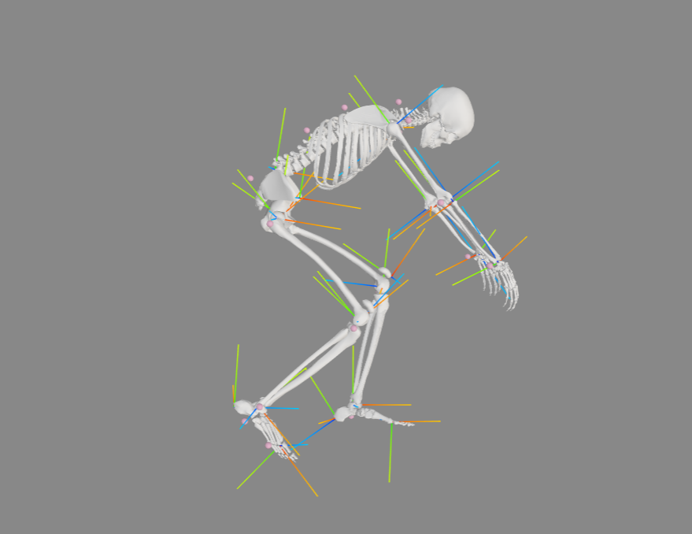

# 👋 Hi, I'm Pascal!

 

- 🎓 **Studying:** Computer Science Master's at ETH Zürich, focusing on computer vision and machine learning.
- 🤖 **Robotics:** Computer vision engineer at [NomadZ](https://github.com/nomadz-ethz), ETH's RoboCup team. I generate synthetic training data for object detection on our Booster K1 humanoids.
- 📂 **Building:** Leading Novalis, an AI compliance assistant that answers questions from a company's own documents, with sources, and runs fully on-premise. Currently in pilot.
- ⚽ **Previously:** Data science intern in UEFA's Women's Football Development unit, where I built the team's data warehouse, automated data cleaning and reporting for senior management, and developed predictive models such as match attendance forecasts.
- 💻 **Side projects:** Mostly about my favorite sports (football / cycling) or web apps. That's me on the bike 👉

## 🆕 Latest release

**[isobike](https://isobike.ch)**: plan bike rides by time instead of distance, with isochrones on the map.

## Some (side) projects

Cycling 🚴 :

- 🟢 **isobike** – Plan bike rides by time instead of distance with the help of **isochrones**. Pick a start and the map colours every road in Switzerland by how long it takes to get there, using your rider profile (flat vs. climber, speed), max. gradient and surface. Add waypoints to build a route, check the elevation profile, export as GPX. Runs on a self-built routing graph from OpenStreetMap + swissALTI3D elevation data.
  [GitHub Repo](https://github.com/PascalFewi/isobike) | [Live App](https://isobike.ch)
  
- 🚧 **VeloPose** – Bike fitting from a single video. Grew out of my bachelor thesis *"Monocular Pose Estimation for Bike Fitting"* at ETH's Visual Learning Group: I collected test data in a professional bike-fitting setup, and benchmarked lightweight 2D pose estimation models on how well they recover the joint angles that matter for a fit, not just on keypoint error. Now turning it into a tool: upload a clip of yourself riding, get a joint-angle analysis and a PDF report. Repo and live app coming soon.
 
- 🚧 **KOM QOM** – Explore Strava segments on an interactive map. 
  Find segments by panning/zooming, see stats (length, grade, elevation, KOM times) 
  and difficulty scores based on a physics model.
  [GitHub Repo](https://github.com/PascalFewi/komqom) | [Live App](https://komqom.app) App is under construction right now, as Strava has removed the `/exploreSegments` endpoint in september 2026 ... 😤 )

  
Football ⚽ :

- 🟢 **SRF Tippspiel EV-Optimizer** – A layer on top of the odds-api.io API that computes the expected value of each possible scoreline for the SRF Tippspiel, and surfaces the tip that maximizes your expected points instead of just the most likely result.
  [GitHub Repo](https://github.com/PascalFewi/srf_tippspiel) | [Live App](https://pascalfewi.github.io/srf_tippspiel/)

- 🟢 **Meischter-Rächner** – An interactive table that shows based on the inputed outcomes form the user, when FC Basel would officially become Swiss champion. 
  [GitHub Repo](https://github.com/PascalFewi/Meischter-Raechner) | [Live App](https://pascalfewi.github.io/Meischter-Raechner/)

- 🟢 **20min Fantasy Squad** – Tried to optimize my fantasy squad based on the performance of last season using a knapsack approach for points per cost.  [GitHub Repo](https://github.com/PascalFewi/20minfantasy)

PolyMarket 💠 (Project stopped as too expensive) : 

- 📴 **Polymarket Orderbook Collector** – Archives Polymarket order book data. Collects polymarket bets over the official polymarket websocket and arhcives it.   
  [GitHub Repo](https://github.com/PascalFewi/polymarket-data)

- 📴 **Polymarket Historical Orderbooks API** – Archived Data was made available over the following script. Find the documentation in the Repo, for accessing a sample portion of the data, that is public available.
  [GitHub Repo](https://github.com/PascalFewi/polymarket-api) (Live Demo offline again. To much server costs 💸)

Some Wordpress / WebDev work for clients: 

- **Gedruckt in Basel.** [gedruckt-in-basel.ch/](https://gedruckt-in-basel.ch/)
- **Klick für Druck** [k-f-d.ch/](https://k-f-d.ch/)
- **Quartett Spiel** [auto-quartett.ch](auto-quartett.ch)
- **MBImmoeasy** [www.mbimmoeasy.ch/](https://www.mbimmoeasy.ch/)
- **Druckerei Dietrich** [druckerei-dietrich.ch/](https://druckerei-dietrich.ch/)
- **Blueme Atelier** [blueme-atelier.ch/](https://blueme-atelier.ch/)

---

Always happy to connect or collaborate!
